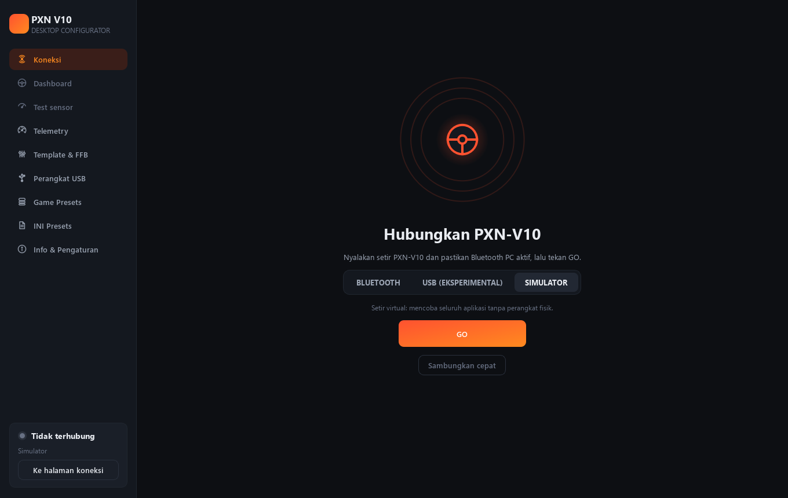
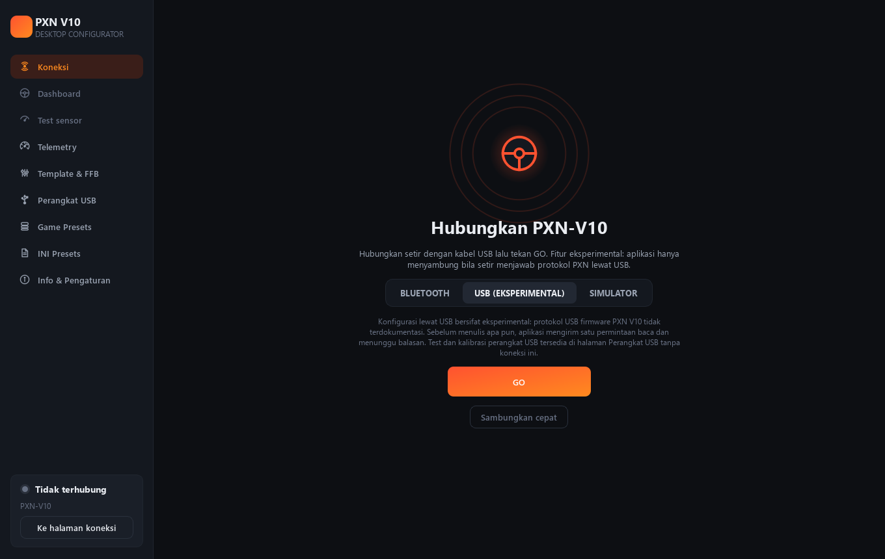
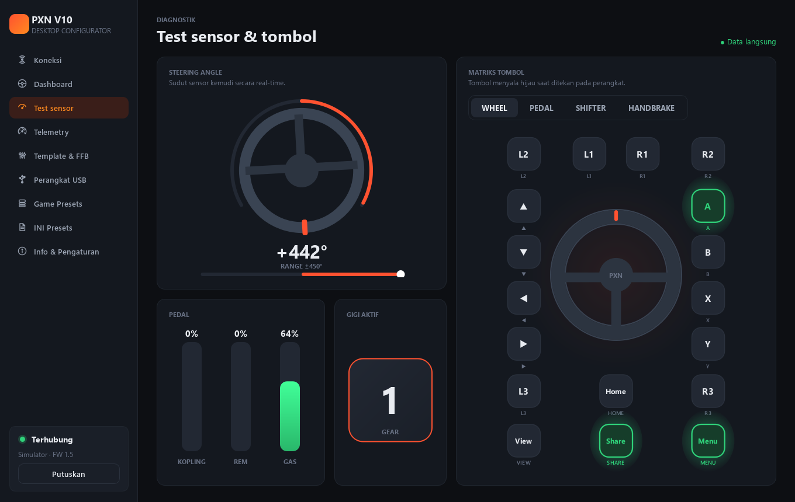
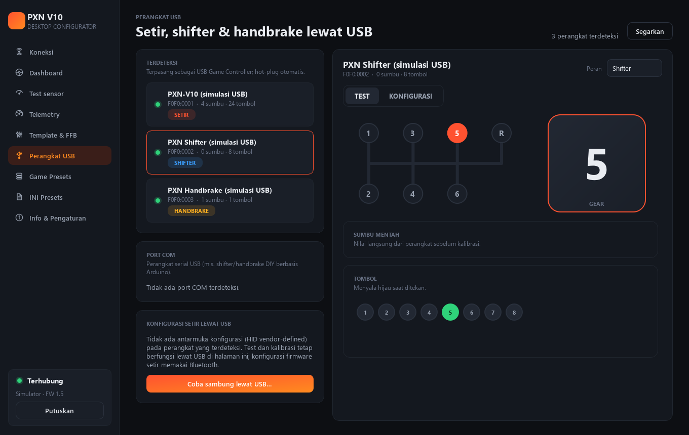
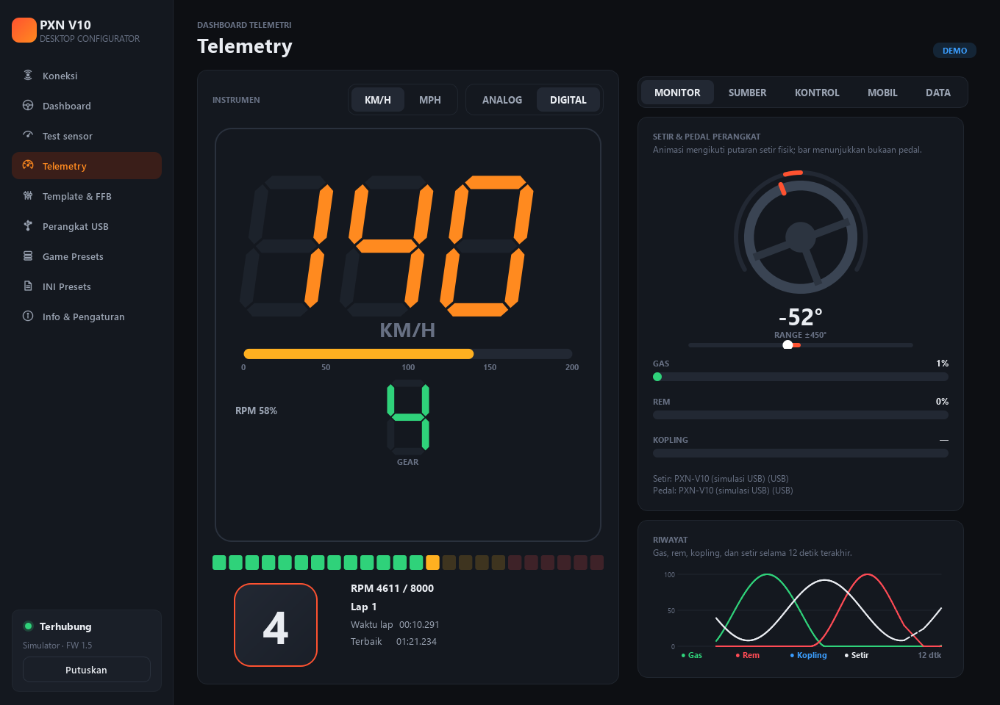
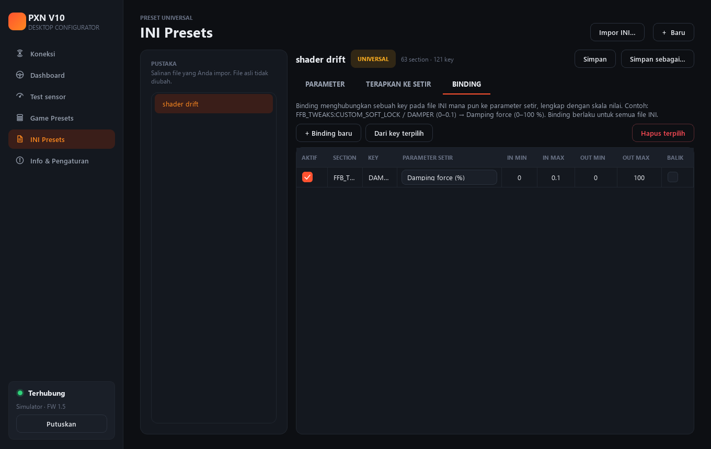

# Torsion Manager

> **Aplikasi desktop modern untuk konfigurasi, tuning, dan optimasi Force Feedback (FFB) setir balap PXN V10 & PXN V99 di Windows.**

---

## 🌟 Overview

**Torsion Manager** adalah software utilitas desktop yang dirancang khusus untuk mempermudah pengguna racing wheel PXN (khususnya seri **PXN V10** dan **PXN V99**) dalam melakukan kalibrasi, penyesuaian profil, pengujian perangkat keras, serta pemantauan telemetri langsung dari PC Windows Anda.

Tanpa perlu repot beralih ke aplikasi smartphone saat bermain simulator balap di PC, Torsion Manager memberikan kendali penuh terhadap seluruh ekosistem kemudi Anda—mulai dari karakteristik Force Feedback (FFB), kurva linearitas pedal, shifter, handbrake USB, hingga instrumen telemetri balap real-time.

### ✨ Fitur Utama

- 🔄 **Koneksi Fleksibel (BLE & USB)**: Mendukung pemindaian dan penyambungan nirkabel Bluetooth Low Energy (BLE) serta mode kabel USB langsung.
- 🏎️ **Tuning Kemudi & Force Feedback**: Atur sudut rotasi (270° hingga 900°), efek return force, damper, friction, dan spring centering secara real-time.
- 🦶 **Kalibrasi Pedal Presisi**: Kustomisasi deadzone, kurva respons linearitas, dan kalibrasi akurat untuk Throttle, Brake, dan Clutch.
- 🕹️ **Pusat Pengujian Hardware (Hardware Test Center)**: Visualisasi input interaktif untuk mendiagnosis setir, tombol, paddle shifter, H-pattern shifter, dan handbrake.
- 📁 **Pustaka Preset & Template Balap**: Dilengkapi template siap pakai untuk berbagai disiplin balap seperti _Race_, _Drift Pro_, _Offroad_, _SUV_, _Realistic_, dan _Extreme_.
- 📊 **Monitor Telemetri & Speedometer Interaktif**: Instrumen gauge analog dan digital interaktif untuk memantau RPM, kecepatan, posisi transmisi, dan telemetri kendaraan.
- ⚙️ **Manajemen Parameter Game INI & Keybinding**: Pencarian parameter, pemetaan tombol (keybinding), dan penerapan konfigurasi game simulator secara instan.

---

## 📸 Antarmuka & Tangkapan Layar

Berikut adalah gambaran antarmuka dan beberapa fitur utama yang tersedia di Torsion Manager:

### 1. Koneksi Perangkat (Bluetooth LE & USB)

Pemindaian otomatis dan deteksi perangkat PXN secara nirkabel maupun berkabel dengan indikator status koneksi yang jelas.

|        Pencarian Perangkat BLE        |                Perangkat Terdeteksi                |           Mode Sambungan USB            |
| :-----------------------------------: | :------------------------------------------------: | :-------------------------------------: |
|  |  |  |

---

### 2. Dashboard Tuning Kemudi & Pedal

Kendali penuh untuk mengubah sudut rotasi setir, kekuatan Force Feedback, damper, serta kalibrasi deadzone dan kurva sensitivitas pedal.

|          Konfigurasi Sudut Putar & FFB           |          Kalibrasi Sensitivitas Pedal           |
| :----------------------------------------------: | :---------------------------------------------: |
|  |  |

---

### 3. Template & Preset Gaya Balap

Pilih profil konfigurasi yang telah dioptimalkan untuk berbagai jenis motorsport atau buat preset khusus Anda sendiri.

|            Template Balap (Race)            |                Template Drift Pro                 |             Preset Manager             |
| :-----------------------------------------: | :-----------------------------------------------: | :------------------------------------: |
|  |  |  |

---

### 4. Pusat Pengujian Input Hardware (Test Center)

Uji respon input setiap komponen perangkat keras secara langsung untuk memastikan semua fungsi berjalan optimal.

|    Pengujian Tombol & Setir     |            Pengujian H-Shifter USB            |              Pengujian Handbrake USB              |
| :-----------------------------: | :-------------------------------------------: | :-----------------------------------------------: |
|  |  |  |

---

### 5. Monitor Telemetri & Speedometer

Visualisasi instrumen balap real-time dengan pilihan tampilan speedometer analog dan digital gauge.

|                  Telemetri Gauge Analog                   |                   Telemetri Gauge Digital                   |                 Speedometer Demo                  |
| :-------------------------------------------------------: | :---------------------------------------------------------: | :-----------------------------------------------: |
|  |  |  |

---

### 6. Pengaturan Game INI & Keybinding

Modifikasi dan terapkan file parameter konfigurasi game simulator balap serta sesuaikan binding tombol kemudi.

|        Parameter Konfigurasi INI         |           Pengaturan Keybinding            |
| :--------------------------------------: | :----------------------------------------: |
|  |  |

---

## 📋 Persyaratan Sistem

Sebelum memulai instalasi, pastikan sistem Anda memenuhi persyaratan berikut:

- **Sistem Operasi**: Windows 10 atau Windows 11 (64-bit)
- **Konektivitas**: Bluetooth Adapter yang mendukung Bluetooth Low Energy (BLE 4.0 atau lebih baru) / Port USB
- **Perangkat yang Didukung**:
  - PXN V10
  - PXN V99
  - Aksesori USB (Shifter & Handbrake)

---

## 🚀 Panduan Instalasi & Menjalankan

Pilih salah satu metode instalasi di bawah ini sesuai kebutuhan Anda:

---

### Metode 1: Menggunakan Installer Windows (Rekomendasi untuk Pengguna)

Cara termudah dan tercepat untuk langsung menggunakan aplikasi tanpa perlu menginstal Python.

1. **Unduh Installer**:
   - Tersedia di folder lokal `Aplication/Torsion-Manager-Setup-1.0.0.exe` atau buka halaman [Releases](https://github.com/) pada repository ini.
   - Unduh/gunakan file installer: `Torsion-Manager-Setup-1.0.0.exe`.

2. **Jalankan Installer**:
   - Klik ganda pada file `Torsion-Manager-Setup-1.0.0.exe`.
   - Jika muncul peringatan _Windows SmartScreen_, klik **More info** lalu pilih **Run anyway**.
   - Ikuti petunjuk wizard instalasi pada layar hingga selesai.

3. **Jalankan Aplikasi**:
   - Buka aplikasi melalui shortcut **Torsion Manager** di Desktop atau melalui menu **Start**.

_(Tersedia juga versi **Portable** dalam folder zip: cukup ekstrak folder dan jalankan `Torsion-Manager.exe`)._

---
